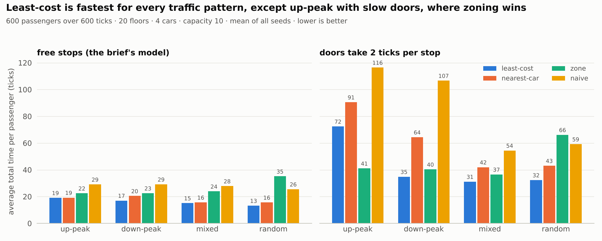
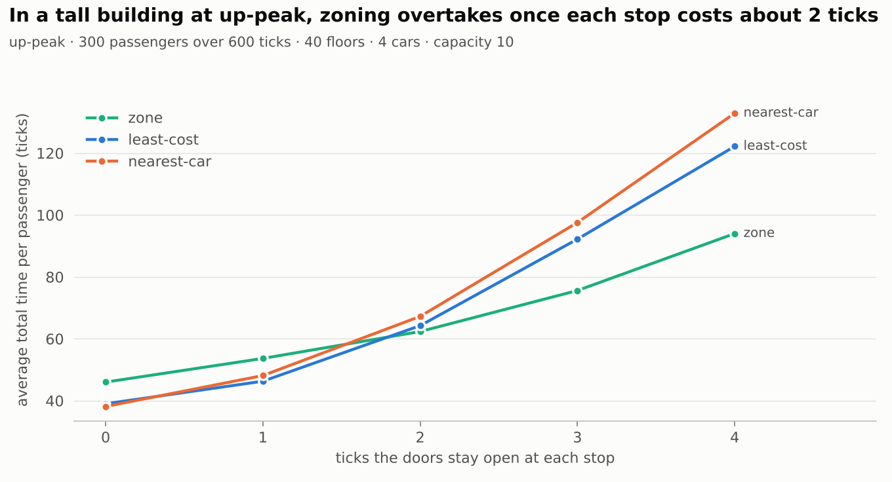
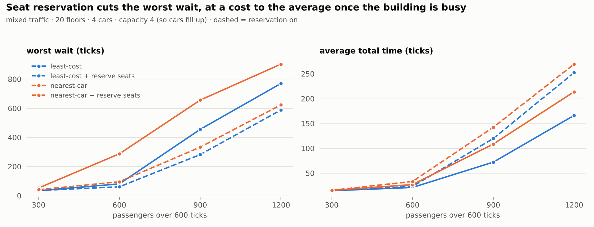
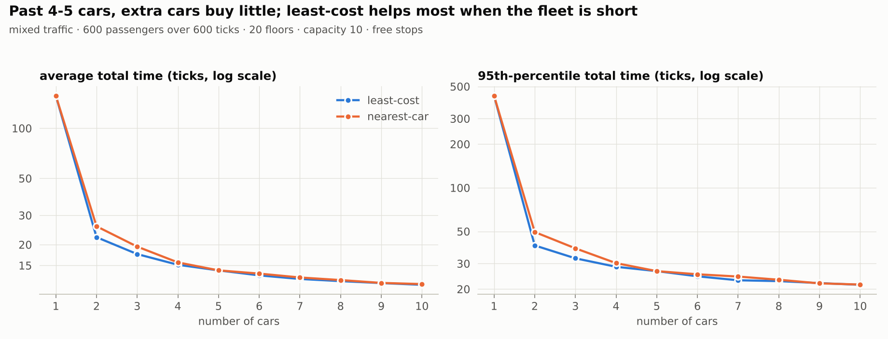

# Elevator Simulation

A discrete-time simulation of a destination-dispatch elevator system in Python. Passengers enter their destination on a keypad at their floor, so the system knows where they are and where they're going. They get assigned a car immediately, and the simulation steps forward one floor of travel per tick without ever looking ahead in the request list.

The default scheduler, `least-cost`, gives each request to the car where it adds the least total time for everyone. In the 20-floor comparison with the brief's free stops, it was the fastest for every traffic pattern. Zoning did better during the morning rush once stops were slow. Cars also hold seats for passengers who asked earlier, so a steady stream of newer passengers can't keep someone waiting.

Time spent: ~4 hours.

## Running it

You need Python 3.10+. The simulator itself has no dependencies. The charts in the experiment script need matplotlib (`pip install -r requirements-optional.txt`).

```bash
# the example from the brief
python -m elevator_sim data/brief_example.csv

# 100 passengers, 10 floors, 3 cars that hold 8 people each
python -m elevator_sim data/normal_100.csv --floors 10 --elevators 3 --capacity 8

# tests
python -m unittest discover -s tests -t .

# a longer randomized stress test (Mac/Linux; on Windows PowerShell: $env:STRESS_RUNS=1000; python -m unittest tests.test_stress)
STRESS_RUNS=1000 python -m unittest tests.test_stress
```

Main options:

- `--elevators` (default 3), `--floors` (defaults to the highest floor in the file), `--capacity` (default 8)
- `--scheduler`: `least-cost` (default), `nearest-car`, `zone` or `naive`
- `--door-time N`: make every stop cost N ticks. The default is 0, as in the brief.
- `--no-reserve-seats`: turn off the fairness rule described below (it's on by default)
- `--positions-log PATH`: where the position log goes (default `elevator_positions.csv`)

The input CSV can use the brief's header (`time,id,source,dest`) or `time,passenger_id,source,destination`. Bad rows are rejected with the line number.

### Output

The position log has one row per tick, starting at 0, with each car's floor:

```
time,elevator_0,elevator_1,elevator_2
0,1,1,1
1,2,1,1
2,3,2,1
```

When the run ends it prints the stats:

```
ticks simulated : 205
requests        : 100
completed       : 100

                min   p50   p95   max      avg
wait time         0     2     7    10     2.69
travel time       1     4     9     9     4.63
total time        1     7    16    19     7.32

longest wait : p40 waited 10 ticks (floor 1 -> 10, requested at t=56)

elevator   floors moved  stops  carried  peak load  moving
0                   138     49       30          3     67%
1                   162     43       35          4     79%
2                   144     51       35          3     70%
```

### Other scripts

```bash
# animated replay of a run, as a single HTML file you open in a browser
python -m elevator_sim.replay data/normal_100.csv --floors 10 --out replay.html

# generate traffic (lobby-heavy or uniform random)
python -m elevator_sim.generators normal data/day.csv --passengers 300 --ticks 600 --floors 20 --seed 1
python -m elevator_sim.generators random data/uniform.csv --passengers 300 --ticks 600 --floors 20 --seed 1

# rerun all the experiments below (~10 min; --quick for a 1-minute version)
python -m elevator_sim.experiments
```

There are a few pre-built replays in `demo/`, including the same 40-floor morning rush run by the zone and least-cost schedulers.

## How it works

Each tick, in order: cars move one floor, riders get off, new requests are assigned a car, waiting passengers board, and the scheduler re-plans every car's stops. For example, if someone on floor 1 asks for floor 4 at t=2 and a car is idle there, they're assigned and board at t=2 (a wait of 0), pass floors 2 and 3 at t=3 and t=4, and get off at t=5, for a total time of 3. Requests only reach the simulation through a feed that releases them when their time comes, so the scheduler can't peek ahead.

The elevator rules live in the `Elevator` class, not in the schedulers, so a scheduler can't break them by accident. Breaking one stops the run with an error. The rules:

- a car never exceeds its capacity
- once it's heading one way, it keeps going until everyone who wants that direction (riding, or assigned and waiting ahead) is served
- a car only picks up passengers going its way
- it can't skip a floor where someone wants off, or where its passenger is waiting and there's room
- a car with work can't sit still

### Schedulers

- `naive`: round-robin assignment, and every car sweeps the whole building stopping at every floor. It's the baseline.
- `nearest-car`: assigns each request to the car that can pick it up soonest, and routes cars LOOK-style (finish everything in one direction, then turn).
- `zone`: each car serves the lobby plus its own block of floors, and trips between blocks change cars at the lobby. This is my take on the express-elevator bonus.
- `least-cost`: assigns each request to the car where it adds the least total time, counting the passenger's own trip and the delay their stop causes everyone else in that car. Same routing as nearest-car.

### Fairness

I found a case where a passenger's wait keeps growing as long as new requests keep coming. Assignments are final and a full car is allowed to pass people. With one car and a steady stream of people at the lobby, someone waiting on floor 5 gets passed every time, because the car fills up at the lobby first. In `tests/test_fairness.py`, that passenger is served last, and their wait grows with every lobby request added.

Seat reservation prevents this in the scenarios I tested, and it's on by default. A car holds a seat for anyone who asked earlier and is waiting further along its route, so newer passengers can't take every seat. In the test case, that passenger's wait stops growing and stays at 22 ticks, however many requests are added.

## Results

The numbers are averages over 10 random seeds (for p95, that's the average of each run's p95). Full tables are in `results/summary.md`. The scheduler comparisons were run with seat reservation off, to compare the schedulers themselves, and the fairness chart shows what turning it on costs.



In this 20-floor comparison with free stops, least-cost had the lowest average and 95th-percentile times for every traffic pattern. One thing I didn't expect: when stops are free and a loaded car never turns back, every ride takes exactly its floor distance. So the only thing a scheduler can actually improve is waiting time.



Once stops cost time, zoning starts to pay off. In a 40-floor building during the morning rush, zoning overtakes least-cost at about 2 ticks per stop and is clearly ahead at 4 (94 vs 122). Zone cars stop less often and get back to the lobby sooner. So there isn't one best scheduler; it depends on the building and the traffic.



Reserving seats cuts the worst wait a lot (287 to 96 ticks for nearest-car at 600 passengers) but raises the average, because cars sometimes travel with a held seat empty. At light load it makes almost no difference. I made it the default because the brief's first goal is that nobody waits forever, and `--no-reserve-seats` is there for anyone who'd rather have the lower average.

The experiments also caught a bug. During the morning rush, the smart schedulers were doing worse than the naive one on long waits. Their route planner assumed everyone boards when the car arrives, but cars fill up at the lobby, so people were assigned to cars that would show up full. Making the planner count seats brought least-cost's average there from 30.5 down to 19.0.



Adding cars helps a lot up to about 4 or 5, then levels off. Least-cost's edge over nearest-car is biggest when the fleet is short (22 vs 26 ticks with 2 cars), and gone by 5.

## Assumptions and simplifications

- Floors are numbered 1 to N, and all cars start empty at floor 1.
- A request at time t is assigned at tick t, and can be picked up in that same tick if a car is there, so a wait of 0 is possible.
- Doors, boarding and getting off take no time unless you set `--door-time`.
- Assignment is immediate and final. A passenger only boards the car they were given.
- My reading of "direction logic": the direction lock also covers assigned passengers waiting ahead, cars only take passengers going their way, and a car with work keeps moving.
- Requests at the same tick are handled in file order.
- Zone transfers happen at the lobby and take no time.
- There's no acceleration, and cars don't get in each other's way.
- If a run hits `--max-ticks` before everyone is delivered, it reports the passengers it didn't deliver and exits with code 1.

## Trade-offs

- Putting the rules in the model means more code in one class, but every scheduler is checked the same way.
- The run crashes on a rule violation instead of quietly fixing it. I'd rather see bugs than get misleading numbers.
- Assignment is greedy, one request at a time, since the brief doesn't allow looking ahead and assignments can't be changed.
- Every car's route is re-planned every tick. It's simple and fast enough for normal loads (a 600-passenger run takes 0.15–0.3 s), but it slows down when hundreds of passengers are queued, since each plan covers everyone waiting for that car.
- Seat reservation is on by default. It costs some average time when the building is busy, but it's what stops passengers being passed over indefinitely. I've checked that with the adversarial test above and the randomized stress tests, though I haven't formally proven it.

## What I'd do with more time

The simulation can already generate and measure rush-hour traffic, but the controller doesn't adapt to it. That's where I'd go next:

- Detect rush periods from recent requests and switch strategy, for example zoning during the morning rush and least-cost the rest of the day.
- Add sky lobbies, with express shuttles from the ground floor to transfer floors higher up and local cars above them. The scheduler can already route passengers through any transfer floor.
- Move idle cars to where demand is likely, like the lobby before the morning rush or busy floors at lunch.
- Size zones by traffic instead of giving each car the same number of floors.
- Let the controller quietly reassign a passenger to another car before pickup (the brief rules this out, but it would fix most of the fairness problem), and add a fairness penalty to least-cost instead of an on/off switch.
- Make door time depend on how many people get on or off, and test against real traffic data.
